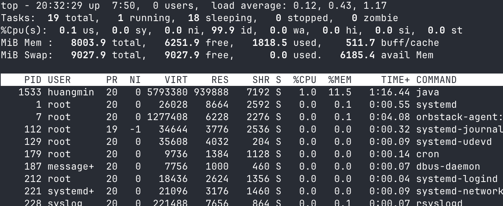

Java 生产故障排查实战：CPU 100% 与 AB-BA 死锁全链路复盘

> **文档导读**：本文基于 **JDK 21 + Spring Boot** 构建供应链核心服务故障沙箱，完整复现线上高频的「**脏配置成环引发 CPU 100%**」与「**锁顺序交叉引发 AB-BA 死锁**」双重并发故障。内容涵盖 **macOS + OrbStack Linux 双环境搭建 $\rightarrow$ 故障注入与现场快照落盘 $\rightarrow$ OS 原生与 Arthas/JFR/Async-Profiler 双链路根因定位 $\rightarrow$ 紧急止损与架构级长效防御 $\rightarrow$ 架构师级面试连环追问复盘**。

## 0. 环境与工具准备

### 0.1 macOS（Apple Silicon）本地基线环境

在 macOS 本地终端通过 `Homebrew` 一键安装压测与现代诊断工具链（确保本地已安装 JDK 21 与 Maven）：

```bash
# 1. 验证 JDK 21 与 Maven 环境
java -version   # 确认输出包含 version "21.x"
mvn -v

# 2. 安装 HTTP 压测工具 wrk 与原生火焰图分析工具 async-profiler
brew install wrk async-profiler

# 3. 下载阿里巴巴 Java 在线诊断工具 Arthas（未上架 Homebrew，统一下载至 ~/.arthas 目录）
mkdir -p ~/.arthas
curl -fL --create-dirs -o ~/.arthas/arthas-boot.jar https://arthas.aliyun.com/arthas-boot.jar
# 若官方源网络波动，可使用 GitHub Release 备用源：
# curl -fL --create-dirs -o ~/.arthas/arthas-bin.zip "https://github.com/alibaba/arthas/releases/download/arthas-all-4.3.5/arthas-bin.zip" && unzip -oq ~/.arthas/arthas-bin.zip -d ~/.arthas && rm -f ~/.arthas/arthas-bin.zip
```

### 0.2 OrbStack Linux 演练环境（用于实操 `top -Hp` 与 `perf`）

由于 macOS 内核（XNU）的 `top` 不支持 Linux 的 `-Hp` 线程级视图，推荐在 Mac 上使用 **OrbStack** 轻量级启动一台 Ubuntu Linux 虚拟机进行真实生产命令演练：

> **文件零传输提示**：OrbStack 默认将 macOS 宿主机的文件系统自动挂载到 Linux 虚拟机内的**完全相同路径**下，无需配置 `scp` 或共享卷。在 macOS IDEA 中完成编码与 `mvn package` 后，切到 OrbStack Linux 终端进入对应目录即可直接运行 `java -jar` 与 `top -Hp`：
> - **路径模板**：`cd /Users/<macOS用户名>/<项目相对路径>`
> - **本机示例**：`cd /Users/huangmin/github-labs/java-troubleshooting-labs/02-high-cpu-deadlock/supply-chain-engine`

```bash
# 1. macOS 端安装并首次拉起 OrbStack 后台服务（等待顶部菜单栏出现 OrbStack 图标）
brew install --cask orbstack
open -a OrbStack

# 2. 创建并进入 Ubuntu 虚拟机（若终端拉镜像超时，可直接在 OrbStack 界面点 Machines -> + 创建）
orb create ubuntu jvm-lab
orb -m jvm-lab

# 3. 在虚拟机内安装 JDK 21 与 wrk（足以完成 top -Hp + jstack/jcmd + Arthas 全部排障演练）
sudo apt update && sudo apt install -y openjdk-21-jdk wrk

# 4. [可选] 若需体验 perf 命令，需手动软链通用版二进制以绕过 OrbStack 定制内核版本检查
sudo apt install -y linux-tools-common linux-tools-generic
sudo ln -sf $(find /usr/lib/linux-tools -name perf | head -n 1) /usr/local/bin/perf
```


---

## 1. 故障现象

模拟业务背景为**供应链履约中心的「跨仓库存调拨」与「动态路由拓扑寻址」核心服务**。版本发布并推送一版供应链路由配置后，线上监控出现以下典型告警与异常特征：

* **主机与容器监控（Prometheus + Grafana）**：
  * 节点 CPU 使用率瞬间飙升并稳定在 **200% ~ 400%**（随上游网关超时重试逐步打满多核），其中用户态 **`us` 占比高达 96% 以上**，内核态 `sy` 低于 2%，系统 Load Average 持续走高。
  * JVM GC 频率、停顿时间与堆内存水位完全正常（排除了频繁 Young GC / Full GC 引发的 CPU 飙升）。
* **线程池与线程状态监控**：
  * Tomcat 工作线程池（`http-nio-8080-exec-*`）活跃线程数持续攀升直至打满上限（40），请求队列 `accept-count` 积压并开始丢弃连接。
  * JVM 线程状态分布呈现两极分化：部分线程长期处于 **`RUNNABLE`** 且单线程 CPU 时间片持续增长；另一批线程永久停留在 **`BLOCKED`** 状态且 CPU 消耗为 `0%`。
* **接口 SLA 与异常日志**：
  * `/api/v1/routing/optimal`（路由寻址）与 `/api/v1/inventory/transfer`（跨仓调拨）P99 耗时从 `12ms` 恶化至 `30s+`，上游网关大面积抛出 `504 Gateway Timeout`。
  * **日志特征极具迷惑性**：死循环线程没有任何业务异常日志（静默吞噬 CPU）；死锁线程仅在触发上游超时断连时，零星打印 `ClientAbortException: Broken pipe` 或线程池拒绝异常，核心业务逻辑无任何报错堆栈。

---

## 2. 复现步骤

> **本节职责边界**：仅负责**构建沙箱服务 $\rightarrow$ 注入双向死锁与死循环流量 $\rightarrow$ 观测宏观异常指标并趁热固化线程快照**。具体的进制转换、堆栈过滤与根因剖析统一放在 **「第 3 节：排查与根因定位」** 中进行，避免实操步骤重复。

### 2.1 编写故障模拟代码

创建 Maven 工程 `supply-chain-engine`（统一包路径 `com.mhuang.sce`），完整目录结构参照文末附录。

**1. `pom.xml`**

```xml
<?xml version="1.0" encoding="UTF-8"?>
<project xmlns="http://maven.apache.org/POM/4.0.0" xmlns:xsi="http://www.w3.org/2001/XMLSchema-instance"
         xsi:schemaLocation="http://maven.apache.org/POM/4.0.0 https://maven.apache.org/xsd/maven-4.0.0.xsd">
    <modelVersion>4.0.0</modelVersion>
    <parent>
        <groupId>org.springframework.boot</groupId>
        <artifactId>spring-boot-starter-parent</artifactId>
        <version>4.1.2</version>
        <relativePath/> <!-- lookup parent from repository -->
    </parent>
    <groupId>com.mhuang</groupId>
    <artifactId>supply-chain-engine</artifactId>
    <version>1.0.0</version>
    <name>supply-chain-engine</name>
    <description>supply-chain-engine</description>

    <properties>
        <java.version>21</java.version>
    </properties>
    <dependencies>
        <dependency>
            <groupId>org.springframework.boot</groupId>
            <artifactId>spring-boot-starter-webmvc</artifactId>
        </dependency>

        <dependency>
            <groupId>org.springframework.boot</groupId>
            <artifactId>spring-boot-starter-webmvc-test</artifactId>
            <scope>test</scope>
        </dependency>
    </dependencies>

    <build>
        <plugins>
            <plugin>
                <groupId>org.springframework.boot</groupId>
                <artifactId>spring-boot-maven-plugin</artifactId>
            </plugin>
        </plugins>
    </build>
</project>
```

**2. `src/main/resources/application.yml`**

```yaml
server:
  port: 8080
  tomcat:
    threads:
      max: 40          # 调小工作线程池，便于本地快速复现线程耗尽雪崩
      min-spare: 10
    accept-count: 50

spring:
  application:
    name: supply-chain-engine
```

**3. `src/main/java/com/mhuang/sce/SupplyChainEngineApplication.java`**

```java
package com.mhuang.sce;

import org.springframework.boot.SpringApplication;
import org.springframework.boot.autoconfigure.SpringBootApplication;

@SpringBootApplication
public class SupplyChainEngineApplication {

    public static void main(String[] args) {
        SpringApplication.run(SupplyChainEngineApplication.class, args);
    }
}
```

**4. `src/main/java/com/mhuang/sce/service/InventoryTransferService.java`（故障点 1：锁顺序交叉导致 AB-BA 死锁）**

```java
package com.mhuang.sce.service;

import org.springframework.stereotype.Service;
import java.util.Map;
import java.util.concurrent.ConcurrentHashMap;

@Service
public class InventoryTransferService {

    // 模拟各仓库的细粒度内存行锁
    private final Map<String, Object> warehouseLocks = new ConcurrentHashMap<>();
    private final Map<String, Integer> stockLedger = new ConcurrentHashMap<>(Map.of(
            "WH-SH:SKU-001", 1000,
            "WH-BJ:SKU-001", 1000
    ));

    /**
     * 故障代码：直接按照调用方传入的 fromWh -> toWh 顺序加锁
     * 当并发出现 A->B 与 B->A 双向调拨时，必然触发 AB-BA 死锁
     */
    public String transferStock(String fromWh, String toWh, String sku, int count) {
        Object firstLock = warehouseLocks.computeIfAbsent(fromWh, k -> new Object());
        Object secondLock = warehouseLocks.computeIfAbsent(toWh, k -> new Object());

        synchronized (firstLock) {
            // 模拟校验源仓库库存、记录流水等耗时操作，放大锁竞争窗口
            sleepQuietly(100);

            synchronized (secondLock) {
                String fromKey = fromWh + ":" + sku;
                String toKey = toWh + ":" + sku;
                int current = stockLedger.getOrDefault(fromKey, 0);
                if (current < count) {
                    return "INSUFFICIENT_STOCK";
                }
                stockLedger.put(fromKey, current - count);
                stockLedger.put(toKey, stockLedger.getOrDefault(toKey, 0) + count);
                return "SUCCESS: " + fromWh + " -> " + toWh + " (" + count + ")";
            }
        }
    }

    private void sleepQuietly(long millis) {
        try {
            Thread.sleep(millis);
        } catch (InterruptedException e) {
            Thread.currentThread().interrupt();
        }
    }
}
```

**5. `src/main/java/com/mhuang/sce/service/RoutingCalculateService.java`（故障点 2：脏配置成环导致无界循环计算）**

```java
package com.mhuang.sce.service;

import org.springframework.stereotype.Service;
import java.nio.charset.StandardCharsets;
import java.security.MessageDigest;
import java.security.NoSuchAlgorithmException;
import java.util.Map;

@Service
public class RoutingCalculateService {

    // 模拟配置中心下发的仓间路由下一跳拓扑：
    // 运维误操作将 WH-NJ 的下一跳配置回 WH-SH，形成闭环 WH-SH -> WH-HZ -> WH-NJ -> WH-SH
    private final Map<String, String> nextHopTopology = Map.of(
            "WH-SH", "WH-HZ",
            "WH-HZ", "WH-NJ",
            "WH-NJ", "WH-SH",
            "WH-GZ", "WH-SZ" // 正常无环链路
    );

    /**
     * 故障代码：缺少环路检测与最大跳数限制，且循环内包含密集哈希/浮点权重计算（防止被 JIT 消除）
     */
    public String calculateOptimalHub(String startWh) {
        String current = startWh;
        double routeCostScore = 0.0;

        while (current != null) {
            // 模拟复杂路由运费与时效权重计算（CPU 密集型）
            routeCostScore += computeHopWeight(current, routeCostScore);
            String next = nextHopTopology.get(current);
            if (next == null) {
                return String.format("TerminalHub=%s, CostScore=%.4f", current, routeCostScore);
            }
            current = next;
        }
        return "UNREACHABLE";
    }

    private double computeHopWeight(String node, double seed) {
        try {
            MessageDigest md = MessageDigest.getInstance("SHA-256");
            byte[] hash = md.digest((node + seed).getBytes(StandardCharsets.UTF_8));
            return Math.abs(Math.sin(hash[0])) * 10.5;
        } catch (NoSuchAlgorithmException e) {
            return 1.0;
        }
    }
}
```

**6. `src/main/java/com/mhuang/sce/controller/SupplyChainController.java`**

```java
package com.mhuang.sce.controller;

import com.mhuang.sce.service.InventoryTransferService;
import com.mhuang.sce.service.RoutingCalculateService;
import org.springframework.http.ResponseEntity;
import org.springframework.web.bind.annotation.*;

@RestController
@RequestMapping("/api/v1")
public class SupplyChainController {

    private final InventoryTransferService transferService;
    private final RoutingCalculateService routingService;

    public SupplyChainController(InventoryTransferService transferService,
                                 RoutingCalculateService routingService) {
        this.transferService = transferService;
        this.routingService = routingService;
    }

    @PostMapping("/inventory/transfer")
    public String transfer(@RequestParam String fromWh,
                           @RequestParam String toWh,
                           @RequestParam(defaultValue = "SKU-001") String sku,
                           @RequestParam(defaultValue = "10") int count) {
        return transferService.transferStock(fromWh, toWh, sku, count);
    }

    @GetMapping("/routing/optimal")
    public String optimalRoute(@RequestParam String startWh) {
        return routingService.calculateOptimalHub(startWh);
    }

    @ExceptionHandler(IllegalStateException.class)
    public ResponseEntity<String> handleIllegalState(IllegalStateException ex) {
        return ResponseEntity.unprocessableEntity().body("FAST_FAIL: " + ex.getMessage());
    }
}
```

### 2.2 编译打包并启动目标应用

> **工具边界说明（本阶段无需 Arthas）**：
> * **2.2 ~ 2.3 阶段职责**：仅负责**制造故障现场**（终端 A 发起双向调拨死锁与 `wrk` 死循环压测）和**确认宏观症状与快照落盘**（终端 B 仅使用 OS 原生 `top` 观测 CPU 飙升，配合 JDK 原生 `jps`、`jstat` 排除 GC 异常，并用 `jstack` 固化快照）。全程无需挂载任何外部诊断 Agent。
> * **Arthas 登场时机**：只有当你在本步通过 `top` 确认 CPU 确实飙升至 200%、且请求卡死后，进入 **「第 3 节：排查与根因定位」** 时，才按需使用 Arthas 或原生工具深入剖析。

先在工程根目录编译打包：

```bash
cd /Users/huangmin/github-labs/java-troubleshooting-labs/02-high-cpu-deadlock/supply-chain-engine
mvn clean package -DskipTests
```

使用 `orb -m jvm-lab` 命令登录虚拟机并启动应用（若在 OrbStack Linux 中演练，直接进入同一宿主机挂载目录运行 `java -jar` 即可；开启 JFR 持续飞行记录以备事后溯源）：

```bash
orb -m jvm-lab
cd /Users/huangmin/github-labs/java-troubleshooting-labs/02-high-cpu-deadlock/supply-chain-engine

java -Xms1g -Xmx1g -XX:+UseG1GC \
     -XX:StartFlightRecording=disk=true,dumponexit=true,filename=incident.jfr,settings=profile \
     -jar target/supply-chain-engine-1.0.0.jar
```


### 2.3 故障注入与实时指标观测（双终端配合）

> **环境前提**：以下操作均需在进入虚拟机（`orb -m jvm-lab`）的终端中执行。若使用 Ghostty 终端且首次连接未导入过 `terminfo`，请先在虚拟机内执行 `export TERM=xterm-256color` 避免 `top` 静默退出（永久修复见文末踩坑日记）。

打开 **2 个** 终端窗口并均登录至 `jvm-lab` 虚拟机，按以下时序配合操作：

#### 终端 A：注入故障流量（并发逆向调拨 + 路由死循环压测）

按顺序执行以下两步（第 1 步会在后台挂起，不阻塞第 2 步执行；若后续在终端 B 来不及抓完快照，切回本窗口按 `↑` 回车重新发起压测即可）：

```bash
# 1. 后台同时发起两笔反向调拨请求，触发 AB-BA 死锁（请求将永久挂起不返回，不加 -s 方便观察连接挂起状态）
curl -X POST "http://127.0.0.1:8080/api/v1/inventory/transfer?fromWh=WH-SH&toWh=WH-BJ&count=5" &
curl -X POST "http://127.0.0.1:8080/api/v1/inventory/transfer?fromWh=WH-BJ&toWh=WH-SH&count=5" &

# 2. 确认请求卡住后，可通过 jstack 抓取线程栈验证死锁
jps -l # 获取PID
jstack <PID> | grep -A 20 "Found one Java-level deadlock"

# 3. 发起 wrk 压测，持续 60 秒（Mac Air M5 控制 -t2 避免机身降频）
wrk -t2 -c2 -d60s "http://127.0.0.1:8080/api/v1/routing/optimal?startWh=WH-SH"
```


#### 终端 B：实时指标观测与现场固化（在同一窗口内依次执行）

> **核心原则（去哪做 & 何时做）**：
> 1. **执行位置**：所有命令均在 `jvm-lab` 虚拟机内的**终端 B** 顺序执行（复用同一窗口即可，不在 Mac 宿主机执行）。
> 2. **卡准 60 秒窗口期**：「看指标 + 存快照」（第 2~4 步）**必须趁热在终端 A 的 60 秒压测期内完成**；一旦第 4 步将快照写入 `jstack.log`，后续第 3 节的进制转换与代码检索即使压测已结束也可从容进行。
> 3. **区分「进程 PID」与「线程 TID」**：`top -Hp` 最左侧第一列表头仍显示为 `PID`，但实际列出的是各个内核线程的**十进制 TID（LWP）**。第 2 步抄录高占用线程的十进制编号（留待第 3 节使用），**第 3、4 步命令的参数依然必须填第 1 步获取的 `<进程PID>`**。

```bash
# 1. 获取 supply-chain-engine 的【进程PID】（建议在终端 A 启动压测前先执行）
jps -l

# 2. 压测期间实时观测进程内所有内核线程（LWP）CPU 占用
#    操作流程：按 Shift+P 按 CPU 降序排列 -> 抄录最左侧第一列占满 CPU 的两个【十进制线程号】（如 708） -> 按 q 退出
top -Hp <进程PID>


# 3. 退出 top 后立即执行，验证 GC 是否正常（每 1000ms 采样一次，共 5 秒，注意参数仍为【进程PID】）
jstat -gcutil <进程PID> 1000 5

# 4. 趁压测仍在运行，立刻将高负载瞬间的线程快照固化到文件（与 jcmd <进程PID> Thread.print > jstack.log 等价）
jstack <进程PID> > jstack.log

# [生产标准增强] 真实线上排查推荐间隔 3 秒连续抓取 3 份快照，便于后续对比实锤线程是否真卡死：
# for i in 1 2 3; do jstack <进程PID> > jstack_${i}.log; sleep 3; done
```


### 2.4 预期观测结果（复现成功判据）

当观察到以下现象并生成快照文件后，说明故障复现与现场保全已成功闭环，可正式进入第 3 节进行根因定位：

* **CPU 维度**：`top -Hp` 中可看到 Java 进程总 CPU 稳定在 **200% 左右**，其中有 **2 个业务线程（`http-nio-8080-exec-*`）各自占用 ~96.3% CPU**（已抄录其十进制 TID）。
* **GC 维度**：`jstat` 输出中的 `YGC` / `FGC` 次数与耗时在压测期间几乎无增长，排除频繁垃圾回收的干扰，确认 CPU 完全消耗在业务线程中。
* **接口与现场留存维度**：终端 A 的两笔调拨请求永久阻塞无响应；当前目录下已成功生成包含高负载瞬间与死锁信息的线程快照文件 `jstack.log`。

---

## 3. 排查与根因定位

遵循线上故障排查黄金法则：**先固化现场快照 $\rightarrow$ 锁定高 CPU 线程与热点代码 $\rightarrow$ 检出阻塞/死锁拓扑 $\rightarrow$ 导出 JFR 与火焰图留证**。

### 3.1 生产排障铁律：为什么必须先固化快照，再离线分析？

在真实企业生产环境中，将 `jstack`（或 `jcmd <PID> Thread.print`）重定向保存到文件（甚至连续保存多份）是标准且关键的故障应急动作，其重要性远高于实验室场景：

1. **止损优先，先保留现场再立刻重启**
   生产环境出现 CPU 打满或死锁时，**第一优先级永远是恢复业务 SLA**（摘除网关流量、重启实例或重建 Pod），绝不允许在线上高压环境中慢悠悠地执行 `grep` 逐行排查代码。标准应急流程是在重启前的几秒钟内迅速执行 `jstack <PID> > jstack.log` 把故障现场固化下来，随后立即重启恢复服务，事后再把日志文件拷出来从容分析根因。
2. **避免多次触发 JVM 安全点（Safepoint）停顿**
   每次执行 `jstack` 或 `jcmd Thread.print` 都会要求 JVM 所有线程进入全局安全点（Safepoint），触发一次短暂的 **Stop-The-World（STW）停顿**。如果直接用 `jstack <PID> | grep ...` 反复查询不同线程，会对本就高负载濒临崩溃的线上服务造成多次额外冲击；先一次性导出到 `jstack.log`，后续在文件中无论 `grep` 多少次，对线上进程都是**零开销**。
3. **生产排查通常需要连抓 2~3 份快照做对比**
   在真实业务中，单次抓拍到某个线程正在执行某行代码，可能只是它恰好运行到一个正常的重计算逻辑，未必是死循环。生产上通常会间隔 **3~5 秒**连续抓取多次（如 `jstack_1.log`、`jstack_2.log`、`jstack_3.log`），对比同一个 `nid` 线程在几秒内是否始终停留在完全相同的方法栈帧上，以此**实锤“死循环”或“死锁”**。
4. **便于从容器中导出并导入可视化工具分析**
   现代生产环境普遍运行在 Docker / K8s 容器中，容器镜像内往往缺少趁手的文本分析工具，且异常 Pod 随时可能因健康检查（Liveness Probe）失败被 K8s 销毁重建。先落盘生成 `jstack.log`，方便直接通过 `kubectl cp <pod>:/path/jstack.log ./` 拷贝到本地，或上传至 **fastThread** 等专业堆栈分析工具一键生成死锁环路与线程池状态诊断报告。

> **进阶提示（底层基本功 vs 现代生产诊断工具）**：
> * **底层通用基本功**：`top -Hp` $\rightarrow$ `printf "%x\n"` 转十六进制 $\rightarrow$ `jstack` / `jcmd Thread.print` 落盘过滤，是只要有基础 OS 与 JDK 就能使用的最底层通用基本功，在金融强合规或受限隔离容器中永远兜底可用；
> * **现代在线诊断利器**：在实际企业生产中，如果服务器部署了阿里开源的 **Arthas**，可以直接用一条 `thread -n 3` 命令全自动合并完成上述采样、排序、进制转换与栈过滤，直接打印出最耗 CPU 的前 3 个线程堆栈；若需排查偶发性 CPU 毛刺或复杂性能瓶颈，则会进一步使用 **JFR（Java Flight Recorder）** 或 **Async-Profiler** 抓取火焰图进行全景分析。

### 3.2 第一步：定位高 CPU 消耗线程与热点代码（现代工具 + OS 原生双链路）

#### 方式 A：现代在线诊断首选 —— Arthas（macOS 与 Linux 完全通用）

Arthas 底层通过 JMX `ThreadMXBean.getThreadCpuTime()` 采样，一步聚合线程 CPU 排名与调用栈（需在压测期间执行）：

> **OrbStack 零传输复用技巧**：如果你正在 OrbStack Linux 虚拟机中演练，**无需在 Linux 内重新下载 Arthas**。由于 OrbStack 自动挂载了宿主机目录，直接在 Linux 终端执行 `java -jar /Users/huangmin/.arthas/arthas-boot.jar <PID>` 即可直接 `attach` 虚拟机内的 Java 进程（若只想基于 2.3 节已抓拍的 `jstack.log` 演练原生离线排查，可直接跳过方式 A 执行方式 B）。

```bash
# 启动 Arthas 并 attach 到目标 PID（macOS 与 OrbStack Linux 通用）
java -jar /Users/huangmin/.arthas/arthas-boot.jar <PID>

# 在 Arthas 交互终端中查看最繁忙的前 3 个线程（采样间隔 1000ms）
[arthas@<PID>]$ thread -n 3 -i 1000
```


**关键输出截取与解读**：

```text
"http-nio-8080-exec-6" Id=45 cpuUsage=96.34% deltaTime=965ms time=16301ms RUNNABLE
    at java.base@21.0.4/java.security.MessageDigest.update(MessageDigest.java:340)
    at java.base@21.0.4/java.security.MessageDigest.digest(MessageDigest.java:411)
    at com.mhuang.sce.service.RoutingCalculateService.computeHopWeight(RoutingCalculateService.java:43)
    at com.mhuang.sce.service.RoutingCalculateService.calculateOptimalHub(RoutingCalculateService.java:30)
    at com.mhuang.sce.controller.SupplyChainController.optimalRoute(SupplyChainController.java:29)
...
"http-nio-8080-exec-7" Id=46 cpuUsage=96.33% deltaTime=965ms time=16297ms RUNNABLE
    at com.mhuang.sce.service.RoutingCalculateService.computeHopWeight(RoutingCalculateService.java:42)
    at com.mhuang.sce.service.RoutingCalculateService.calculateOptimalHub(RoutingCalculateService.java:30)
```

* **解读**：`exec-3` 和 `exec-4` 两个线程各自独占 **~100% 单核 CPU**，状态为 `RUNNABLE`，堆栈精准停留在 `RoutingCalculateService.java:30` 的 `while` 循环内，直接锁定 CPU 飙升元凶。


#### 方式 B：Linux / OrbStack 原生兜底三步法（基于 2.3 节已落盘快照）

在金融强合规（禁止挂载外部 Agent）或怀疑 **GC 线程 / C2 JIT 编译线程 / JNI Native 线程**飙升时（Arthas `ThreadMXBean` 看不到非 Java 线程），直接承接 **2.3 节已记录的高负载线程 TID 与已导出的 `jstack.log`** 进行离线分析（若此前未落盘，可先执行 `top -Hp <PID>` 获取 TID 并执行 `jcmd <PID> Thread.print > jstack.log` 一次性导出）：

```bash
# 1. 若使用 JDK 21+，直接用 top 看到的十进制线程号搜索（无需转换）：
grep -A 25 "nid=708 " jstack.log

# 2. 若使用 JDK 17 及以下，需先转十六进制再搜索：
printf "%x\n" 708   # 输出 2c4
grep -A 25 "nid=0x2c4 " jstack.log

# 3. 通用兼容写法（同时匹配十进制和十六进制，不区分 JDK 版本）：
grep -E -A 25 "nid=(708|0x2c4) " jstack.log

# 4. [多快照实锤] 若连续抓取了多份快照，可对比同一线程在 3 秒内是否始终停留在同一栈帧：
# grep -E -A 10 "nid=(708|0x2c4) " jstack_1.log jstack_2.log jstack_3.log
```

**关键输出截取与解读**：

```text
"http-nio-8080-exec-4" #43 [708] daemon prio=5 os_prio=0 cpu=41069.32ms elapsed=14341.88s tid=0x0000ffff79507e50 nid=708 runnable  [0x0000fffec3ffc000]
   java.lang.Thread.State: RUNNABLE
        at java.security.MessageDigest.digest(java.base@21.0.4/MessageDigest.java:411)
        at com.mhuang.sce.service.RoutingCalculateService.computeHopWeight(RoutingCalculateService.java:42)
        at com.mhuang.sce.service.RoutingCalculateService.calculateOptimalHub(RoutingCalculateService.java:30)
```

* **解读**：通过 Linux `1:1` 线程模型，内核轻量级进程 `708`精准映射到 JVM 线程 `http-nio-8080-exec-4`，直接定位到业务死循环行号 `RoutingCalculateService.java:30`。


### 3.3 第二步：检测线程死锁（离线快照与在线字节码取证）

确认调拨接口卡死且线程池出现大面积 `BLOCKED` 线程后，立即排查锁竞争与死锁。根据现场状态选择排查路径（**优先使用已落盘快照，避免对高负载生产节点重复触发 STW**）：

* **路径 A（首选 · 离线全量分析）**：直接检索上一步导出的 `jstack.log`，零额外线上开销，且能一次性呈现完整的死锁闭环。
* **路径 B（急救 · 在线字节码核验）**：若未留存快照，通过 Arthas 挂载定位单边阻塞源，并反编译线上真实字节码核对行号。

---

#### 路径 A：检索离线 `jstack.log`（零 STW 开销，展示完整闭环）

生产环境 Spring AOP 代理栈较深，检索时建议向后多截取 50 行，防止截断核心业务堆栈：

```bash
grep -A 50 "Found one Java-level deadlock" jstack.log

```

**关键输出截取**：

```bash
Found one Java-level deadlock:
=============================
"http-nio-8080-exec-1":
  waiting to lock monitor 0x0000fffed0071ed0 (object 0x00000000c072e700, a java.lang.Object),
  which is held by "http-nio-8080-exec-2"

"http-nio-8080-exec-2":
  waiting to lock monitor 0x0000fffec40c56a0 (object 0x00000000c072e710, a java.lang.Object),
  which is held by "http-nio-8080-exec-1"

Java stack information for the threads listed above:
===================================================
"http-nio-8080-exec-1":
        at com.mhuang.sce.service.InventoryTransferService.transferStock(InventoryTransferService.java:30)
        - waiting to lock <0x00000000c072e700> (a java.lang.Object)
        - locked <0x00000000c072e710> (a java.lang.Object)
        at com.mhuang.sce.controller.SupplyChainController.transfer(SupplyChainController.java:27)

```


---

#### 路径 B：Arthas 在线诊断与字节码取证（防行号偏移）

```bash
# 1. 一键定位当前阻塞其他线程的源头（仅展示单边阻塞者）
[arthas@<PID>]$ thread -b

# 2. 根据输出中的 "owned by ... Id=40"，拉取另一方堆栈以确认闭环
[arthas@<PID>]$ thread 40

# 3. 反编译线上内存字节码，精确锁定第 29 行真实代码（排除本地源码与容器包版本不一致的干扰）
  [arthas@<PID>]$ jad --source-only com.mhuang.sce.service.InventoryTransferService transferStock

```

**1. `thread -b` 关键输出**：

```text
"http-nio-8080-exec-2" Id=41 BLOCKED on java.lang.Object@7f3bc0aa owned by "http-nio-8080-exec-1" Id=40
    at com.mhuang.sce.service.InventoryTransferService.transferStock(InventoryTransferService.java:29)
-  blocked on java.lang.Object@7f3bc0aa
-  locked java.lang.Object@39eb7225 <---- but blocks 1 other threads!
    at com.mhuang.sce.controller.SupplyChainController.transfer(SupplyChainController.java:27)

```


**2. `jad` 反编译实锤（精确命中第 29 行）**：

```java
/*22*/     Object firstLock = this.warehouseLocks.computeIfAbsent(fromWh, k -> new Object());
/*23*/     Object secondLock = this.warehouseLocks.computeIfAbsent(toWh, k -> new Object());
/*25*/     Object object = firstLock;
           synchronized (object) { // 缺陷：按入参顺序动态加锁，双向并发调拨且窗口重叠时极易引发循环等待
/*27*/         this.sleepQuietly(100L);
/*29*/         Object object2 = secondLock;
               synchronized (object2) { // 阻塞点：双方已持有外层锁并在此互等内层锁（如线程 A 持 WH-SH 等 WH-BJ，线程 B 持 WH-BJ 等 WH-SH）
/*30*/             String fromKey = fromWh + ":" + sku;
/*31*/             String toKey = toWh + ":" + sku;

```


---

#### 根因剖析与底层原理

1. **死锁闭环映射表**（`jstack` 输出对象内存地址，`Arthas` 输出对象 HashCode，两者指向同一组仓库锁实例）：

| 阻塞线程 | 调拨方向 | 已持有锁（`locked`） | 正在等待锁（`waiting / blocked`） |
| :--- | :--- | :--- | :--- |
| `http-nio-8080-exec-1` (`Id=40`) | 上海仓 → 北京仓 | `WH-SH` 锁（`0x...2a00` / `@7f3bc0aa`） | `WH-BJ` 锁（`0x...2a10` / `@39eb7225`） |
| `http-nio-8080-exec-2` (`Id=41`) | 北京仓 → 上海仓 | `WH-BJ` 锁（`0x...2a10` / `@39eb7225`） | `WH-SH` 锁（`0x...2a00` / `@7f3bc0aa`） |

2. **排查细节与 JVM 底层原理**：
- **快速定位业务行**：阅读线程堆栈时直接跳过 JDK 底层及 `org.apache.tomcat`、`org.springframework` 等框架代理层，自上而下第一行业务代码（`InventoryTransferService.java:29`）即为阻塞现场，结合 `jad` 反编译结果中的 `/*29*/` 即可确认卡死在内层 `synchronized` 处。
- **栈帧锁信息合并显示机制**：外层锁（第 25 行 `locked`）已成功获取，线程实际挂起在内层 `monitorenter` 指令（第 29 行 `waiting to lock`）。由于 JVM 堆栈按方法栈帧输出且仅记录当前阻塞指令的程序计数器（PC）行号，同一栈帧内已持有与正在等待的两把锁状态会合并展示在第 29 行下方。
- **工具边界意识**：`thread -b` 底层依赖 `ThreadMXBean` 的 `getLockOwnerId()` 追踪对象监视器（Monitor），仅能识别 `synchronized` 引起的阻塞与死锁；若业务使用 `ReentrantLock` 等 JUC 锁发生死锁，线程处于 `WAITING (parking)` 状态，`thread -b` 会返回空结果（`No most blocking thread found!`），此时需通过 `jstack -l` 或 Arthas 的 `thread --state WAITING` 检索 `java.util.concurrent.locks` 相关堆栈。

> **排查结论与下一步**：根因确认为跨仓库调拨未对锁资源做全局排序。进入 **3.4 节**，采用“按仓库编码字典序统一加锁顺序”破坏循环等待条件，并通过并发压测验证吞吐量恢复情况。

### 3.4 第三步：非侵入式 JFR 热转储与 CPU 火焰图留证

通过 `jstack.log` 固化线程快照、并借助 `Arthas` 完成实时热点定位后，工程排障的最后一步是将瞬时的命令行输出转化为**可离线复盘、具备多维交叉印证能力的标准化诊断产物**——**JFR（Java Flight Recorder）飞行记录**与 **CPU 火焰图**。这两份产物不仅能在服务重启恢复业务后支撑深度根因分析（RCA），也是故障复盘报告中最具说服力的客观铁证。

#### 0. 采样前基线核验与环境一致性保障（Pre-flight Check）

##### 1. 为什么要做基线核验？（底层机制分析）

在本案例的路由计算死循环场景中，`while` 循环体内部仅执行纯 CPU 密集型运算（高频哈希与三角函数计算），不涉及任何网络 Socket 写操作。因此，当压测客户端（`wrk`）因超时主动断连时，服务端不会触发 `Broken pipe` 异常，已分配的 Tomcat Worker 线程将持续处于 `RUNNABLE` 状态并占满 CPU 核心。

若在未重启进程的情况下重复执行压测，会导致死循环线程发生**“线程债务累加”**（例如卡死线程由 2 个累加至 4 个及以上，CPU 占用率由 `~200%` 飙升至 `~400%+`），进而破坏全篇排查报告中 **2.4 节、3.2 节与本节在指标口径上的严格一致性**。因此，每次进入本节采样前必须执行基线核验：

```bash
# 1. 确认目标 Java 进程唯一，且无残留的诊断/辅助进程干扰
jps -l

# 2. 非交互式快照检查当前高 CPU 线程分布（标准基线：2 个业务线程占满 ~200% CPU）
top -Hp <PID> -b -n 1 | head -n 15
```

##### 2. 基线状态判定与标准复位 SOP

| **观测状态**           | **指标特征**                                             | **根因判定**                           | **标准化处理动作**                                           |
| :--------------------- | :------------------------------------------------------- | :------------------------------------- | :----------------------------------------------------------- |
| **状态 ①（标准基线）** | CPU 稳定在 `~200%`，存在 **2 个**业务线程各自占满 `~96%` | 2.3 节注入的故障现场仍在持续           | **严禁重复执行 `wrk`**，直接进入第 1 步采集留证              |
| **状态 ②（冷启动态）** | CPU 低于 `< 15%`，无异常高负载线程                       | 进程曾被重启，故障现场已清空           | 执行单次标准故障注入（锁阻塞 + 单次 `wrk`）后再采集          |
| **状态 ③（基线漂移）** | CPU 达到 `≥ 400%`（4+ 线程占满）或存在残留诊断进程       | 重复压测导致线程债务累加，指标口径失真 | 立即执行下方 **标准复位 SOP** 清理旧进程与历史产物并重建现场 |

**标准复位 SOP 操作步骤：**

1. **清理超载旧进程与历史产物**（在 `jvm-lab` 终端执行）：

   ```bash
   # 1. 检查所有残留 Java / 诊断进程，彻底终止超载的旧应用进程（替换为实际 PID）
   jps -l
   kill -9 <OLD_APP_PID> <RESIDUAL_PID>
   
   # 2. 进入工程目录并清理旧的快照与火焰图产物，防止 400% 脏数据与新产物混淆
   cd $PROJECT_HOME/02-high-cpu-deadlock/supply-chain-engine
   rm -f incident.jfr incident_snapshot.jfr cpu_flamegraph.html
   ```

2. **挂载持续 JFR 录制干净重启应用**（沿用 2.2 节标准启动参数）：

   ```bash
   java -Xms1g -Xmx1g -XX:+UseG1GC \
        -XX:StartFlightRecording=disk=true,dumponexit=true,filename=incident.jfr,settings=profile \
        -jar target/supply-chain-engine-1.0.0.jar
   ```

3. **一次性注入标准复合故障**（新开另一个 `jvm-lab` 终端执行）：

   > **取证设计意图**：为使单份 `incident_snapshot.jfr` 同时固化高负载现场并保持指标口径纯净，在并发触发两笔反向库存调拨后，仅执行**单次**定量 `wrk` 压测：

   ```bash
   # 1. 触发 AB-BA 死锁（后台并发触发，构造永久锁阻塞现场）
   curl -X POST "http://127.0.0.1:8080/api/v1/inventory/transfer?fromWh=WH-SH&toWh=WH-BJ&count=5" &
   curl -X POST "http://127.0.0.1:8080/api/v1/inventory/transfer?fromWh=WH-BJ&toWh=WH-SH&count=5" &
   
   # 2. 仅执行【一次】wrk 压测（精确触发 2 个死循环线程，稳稳锁定 ~200% CPU 基线）
   wrk -t2 -c2 -d60s "http://127.0.0.1:8080/api/v1/routing/optimal?startWh=WH-SH"
   ```

4. **二次复核标准基线**：执行 `jps -l` 与 `top -Hp <PID> -b -n 1 | head -n 15`，确认 Java 进程唯一且**恰好 2 个业务线程各自占 `~99%` CPU（合计 `~200%`）**，随后按下方步骤衔接留证。


> *操作回显：标准基线状态核验（`top -Hp` 确认恰好 2 个业务线程占满 `~200%` CPU）*

#### 1. 非侵入式 JFR 飞行记录热转储（低开销全维度黑匣子取证）

##### 1. 生产级非侵入式 Dump（在 `jvm-lab` 终端执行）

由于应用启动时已挂载持续录制参数（`profile` 模式下额外 CPU 开销通常 `< 1%`），JVM 内部已维护一个编号为 `1`（`name=1`）的后台录制任务（相当于飞机的“黑匣子历史录像”）。排查时无需重启进程，直接通过 `jcmd` 触发热转储（Hot Dump）：

> **注意：Attach 通道互斥与工具执行序规范**
> `jcmd` 依赖目标 JVM 内部唯一的单线程 `Attach Listener` 进行通信。若执行时出现无输出挂起，通常源于两种情况：
>
> 1. 重复压测导致 vCPU $100\%$ 满载，`Attach Listener` 抢不到调度时间片；
> 2. `Arthas` 正在占用 Attach 通道执行采样或字节码增强。
>
> 因此，标准取证顺序应遵循**“先执行 `jcmd` 完成 JFR 转储，再挂载 `Arthas` 采集火焰图”**，避免双诊断工具交叉阻塞。

```bash
# 1. 核验当前运行中的 JFR 录制任务状态
#    - 正常耗时：< 0.5s（非交互式瞬时命令，执行完自动退出，无需按 q）
#    - 预期输出：Recording 1: name=1 ... (running)
jcmd <PID> JFR.check

# 2. 将截止当前时刻的飞行记录热转储为独立快照（不中断原录制任务）
#    - 正常耗时：0.5s ~ 3s（短时同步刷盘，取决于缓冲区大小与磁盘 I/O，实验场景通常 < 1s）
#    - 预期输出：Dumped recording "1"
jcmd <PID> JFR.dump name=1 filename=./incident_snapshot.jfr

# [生产兜底方案] 若线上进程启动时未预设录制参数，可通过 jcmd 动态开启 15s 临时录制：
#    - 正常耗时：< 0.5s（异步下发指令，命令本身不会阻塞终端 15s，下发后立刻返回提示符）
#    - 落盘说明：需手动等待满 15s 后再读取文件（期间可用 JFR.check 观察任务状态从 running 变为 stopped）
# jcmd <PID> JFR.start name=emergency settings=profile duration=15s filename=./incident_snapshot.jfr
```


> *操作回显：`jcmd JFR.check` 任务状态核验与 `JFR.dump` 热转储执行输出*

##### 2. 零传输跨端离线关联分析

得益于 OrbStack 默认将 macOS 宿主机目录自动挂载到虚拟机完全相同的路径下，虚拟机内生成的 `./incident_snapshot.jfr` 会**实时出现在 macOS 本地的同一工程目录中**。在宿主机直接通过 **IntelliJ IDEA** 或 **JDK Mission Control (`jmc`)** 零传输打开，结合同一进程的 `jstack.log` 快照，即可实现 CPU 热点与永久死锁的跨工具双向交叉印证：

- **CPU 热点归因（JFR `Call Tree`）**：`com.mhuang.sce.service.RoutingCalculateService.calculateOptimalHub` 及其子方法 `computeHopWeight` 分别占据了 **`100.0%`** 与 **`97.6%`** 的 CPU 采样样本，直接锁定算力耗尽的调用路径。
- **永久死锁交叉印证（JFR 事件特征 + `jstack.log`）**：由于两笔反向调拨线程陷入**永久死锁**、始终未释放监视器锁，HotSpot JFR 的 `Java Monitor Blocked`（`jdk.JavaMonitorEnter`）结束事件尚未触发（事件计数保持为 `0`），且被操作系统挂起的线程不消耗 CPU（在 CPU 采样视图中无活跃轨迹）；结合同一进程的 `jstack.log` 静态快照，清晰捕获到 `com.mhuang.sce.service.InventoryTransferService.transferStock` 在 `java.lang.Object` 监视器上处于永久 `BLOCKED (on object monitor)` 状态，与 JFR 运行期采样结论形成完整闭环。

**死锁快照同步导出与快速定位命令（在 `jvm-lab` 终端执行）：**

```bash
cd $PROJECT_HOME/02-high-cpu-deadlock/supply-chain-engine

# 1. 获取目标应用 PID
PID=$(jps -l | grep supply-chain-engine | awk '{print $1}')

# 2. 导出/刷新同一进程的线程快照（自动通过 OrbStack 同步至 macOS 本地工程目录）
#    - 兜底机制：若高 CPU 负载导致 jstack 超过 5s 无响应，自动降级使用 jcmd Thread.print 导出
timeout 5 jstack $PID > jstack.log || jcmd $PID Thread.print > jstack.log

# 3. 检索死锁线程堆栈与文末诊断结论，并输出精确行号（便于在 IDEA 中 Cmd + L 快速跳转）
echo "=== [1/2] 死锁线程详细堆栈（BLOCKED 状态上下文） ==="
grep -n -C 12 "BLOCKED (on object monitor)" jstack.log

echo "=== [2/2] JVM 死锁诊断结论摘要（文件末尾） ==="
grep -n -A 35 "Found one Java-level deadlock:" jstack.log
```

- **关联视图制作要点**：在 macOS 宿主机使用 IntelliJ IDEA 打开同目录下的 `jstack.log`，按 `Cmd + L` 输入终端检索出的 `Found one Java-level deadlock:` 行号，即可同屏定位两个互锁线程的 `BLOCKED (on object monitor)` 调用栈及 `java.lang.Object` 监视器地址，与 `incident_snapshot.jfr` 的 `Call Tree` 视图拼接为双联交叉印证图。

> **[图 3-4-1：CPU 热点与锁阻塞双向交叉印证 —— (a) IntelliJ IDEA 解析 `incident_snapshot.jfr` 呈现 `RoutingCalculateService` 热点调用树；(b) `jstack.log` 捕获 `InventoryTransferService.transferStock` 的 `Object` 监视器永久死锁堆栈]**


#### 2. 采集 CPU 火焰图（规避 Safepoint 偏差的精准热点定位）

##### 1. 采样原理与工具选型

与 JFR 的“历史黑匣子录像”不同，CPU 火焰图属于“实时直播采样”（仅统计采样窗口内正在消耗 CPU 的 On-CPU 线程）。传统基于 JVMTI `GetStackTrace` 的采样器受限于 **JVM 安全点偏差（Safepoint Bias）**，容易产生热点误判；而 **Arthas 内置的 `profiler` 模块底层原生集成了 `async-profiler`**（`jvm-lab` 沙箱无需额外安装独立命令行包），通过 OS 级 `perf_events` / `itimer` 结合 JVM `AsyncGetCallTrace` 进行异步栈回溯，可在不触发 STW 的前提下精准还原真实的 CPU 热点：

- **方式 A（推荐 · 复用 Arthas 内置 `profiler` 一键出图）**：

  ```bash
  # 1. 连接目标 JVM 进程（若已在 Arthas 交互终端中则跳过）
  java -jar ~/.arthas/arthas-boot.jar <PID>
  
  # 2. 启动异步 CPU 采样（底层调用 async-profiler）
  [arthas@<PID>]$ profiler start
  
  # 3. 维持高负载窗口约 10 秒后，停止采样并导出交互式 HTML 火焰图
  [arthas@<PID>]$ profiler stop --format html -f ./cpu_flamegraph.html
  ```


- **方式 B（原生 `asprof` 命令行采集 —— 适用于已独立部署 `async-profiler` 的生产节点）**：

  ```bash
  # 采集 10 秒 CPU 火焰图（容器环境下若受限于 perf_event_paranoid 权限，可追加 -e itimer）
  asprof -d 10 -f ./cpu_flamegraph.html <PID>
  ```

##### 2. 火焰图拓扑阅读与“平顶山”根因实锤

在浏览器中双击打开工程目录下的 `cpu_flamegraph.html`，找到并点击 `RoutingCalculateService.calculateOptimalHub` 色块进行局部放大（Zoom In）。放大后该色块横向铺满 100% 视口，其下方的调用入口 `SupplyChainController.optimalRoute` 及更底层的容器调度栈会自动置灰弱化：

- **纵轴（Y 轴）—— 方法调用栈深度：** 自底向上依次展示完整的执行链路，即「线程入口 → Tomcat 容器调度 → Spring MVC 分发 → 业务服务层 → 栈顶热点指令」。在当前局部聚焦视图中，视口底部从 Spring MVC 分发与控制器边界 `SupplyChainController.optimalRoute` 切入，向上经由 `calculateOptimalHub` 进入核心计算方法 `computeHopWeight` 及其内部调用栈。
- **横轴（X 轴）—— 采样样本占比：** 按方法名字母序自左向右排列（**非时间先后顺序**），色块越宽代表该方法在采样周期内占用的 CPU 时间片越多。
- **业务边界定位法则（核心代码锁定技巧）：** 排查 CPU 飙高时无需在底层框架或 JDK 源码中迷失，只需遵循“自底向上跳过框架包名（如 `org.springframework`、`org.apache`），顺着最宽的亮绿色色块向上追踪，停在自家业务包名（`com.xxx`）的最高层”这一视觉口诀。如图中所示，紧挨着上方大片青色（JDK 核心库）与红色（JVM/原生指令）塔楼正下方的最后一层亮绿色长条，正是 `com.mhuang.sce.service.RoutingCalculateService.computeHopWeight`——它既承接了几乎 100% 的业务算力宽度，又是直接触发底层高频计算的“总源头”，即需要打开 IDE 重点排查的核心代码行。
- **栈顶“平顶山”（Flat Top）特征：** 在 `RoutingCalculateService.computeHopWeight` 正上方，火焰图顶端呈现出三片宽阔的“平顶山”与高耸尖峰，从字节码与底层运行时层面实锤 CPU 算力被高频循环计算彻底耗尽：
  1. **高频浮点转字符串（左侧平顶，约占 1/3 宽度）：** 调用栈停留在 `String.valueOf` → `Double.toString`→ `jdk/internal/math/DoubleToDecimal` 系列方法上，暴露出循环内频繁将 `double` 浮点数值拼接或格式化为字符串的隐性开销。
  2. **高频 SHA-256 摘要计算（中部平顶，约占 1/3 宽度）：** 调用栈经 `MessageDigest.digest` → `SHA2.implDigest` 直达栈顶红色原生指令 `sha256_implCompress`，表明大量 CPU 时间片直接消耗在哈希摘要压缩运算中。
  3. **重复实例化加密组件（右侧栈簇，约占 1/3 宽度）：** `MessageDigest.getInstance` 占据了与摘要计算相当的宽度，其上方延伸出 `GetInstance`、`Provider` 反射调用（`java/lang/reflect/..`）及并发容器查找（`java/util/concurr..`），实锤代码在循环内部反复调用 `getInstance` 获取加密实例，引发了严重的重复查找与反射损耗。

> **图：`cpu_flamegraph.html` 局部聚焦视图 —— 栈顶平顶山（`RoutingCalculateService.computeHopWeight`）高占比采样实锤**


#### 3. 生产级安全退出与资源闭环（Graceful Teardown）

诊断取证完成后，**严禁在 Arthas 终端中直接执行 `quit` 或 `exit` 退出**，必须执行 `stop` 指令完成彻底卸载：

```bash
# 1. 在 Arthas 交互终端中重置所有被增强的字节码类，并彻底关闭诊断服务端线程
[arthas@<PID>]$ stop

# 2. 确认所有留证文件与截图核验无误后，在 jvm-lab 终端终止沙箱进程以释放宿主机算力
kill <PID>
```

- **生产安全规范说明**：`quit` 仅断开当前客户端 Socket 连接，Arthas 服务端及此前 `jad` / `profiler` 挂载的 `Instrumentation` 字节码增强仍残留在目标 JVM 中，可能引发 Metaspace 持续增长或接口响应延迟；执行 `stop` 会自动触发 `Resetting all enhanced classes ... Arthas Server is going to shutdown`，确保目标 JVM 零残留恢复至诊断前状态。

> **[图 ：`jvm-lab` 终端完整取证与 Arthas 安全卸载（`Resetting all enhanced classes`）操作闭环记录]**
> *（待插入截图：`jvm-lab` 终端执行 `JFR.dump`、`profiler` 采样及 `stop` 卸载完整闭环）*
>
> 

#### 4. 本阶段核心留证产物汇总

| **产物文件名**              | **采集工具与机制**                    | **核心取证价值**                                             | **生产环境适用性**                              |
| :-------------------------- | :------------------------------------ | :----------------------------------------------------------- | :---------------------------------------------- |
| **`incident_snapshot.jfr`** | `jcmd JFR.dump`（JVM 内置事件引擎）   | 固化运行期 CPU 采样数据（`calculateOptimalHub` 占 `100.0%`、`computeHopWeight` 占 `97.6%`），与 `jstack.log` 永久死锁快照形成跨维度互证 | 极高（持续录制开销 `< 1%`，支持非侵入式热转储） |
| **`cpu_flamegraph.html`**   | Arthas `profiler`（`async-profiler`） | 规避 Safepoint 偏差，通过栈顶“平顶山”直观量化 CPU 时间片消耗分布，一图定位最底层热点方法 | 高（按需启停，采样窗口可控且无字节码侵入）      |

---


### 3.5 根因定位结论（JVM 与 OS 底层机制剖析）

#### 1. CPU 100% 飙升底层机制（无界循环与纯用户态计算）
* **死循环路径与状态映射**：`RoutingCalculateService.calculateOptimalHub` 遍历路由拓扑时命中脏配置有向环（`WH-SH -> WH-HZ -> WH-NJ -> WH-SH`），因缺少环路检测与最大跳数限制而无法退出 `while` 循环。执行线程始终处于 JVM 的 **`RUNNABLE`** 状态，对应 OS 调度器的 **`RUNNING`**（正在占用 CPU 核心）或 **`READY`**（就绪队列等待时间片）状态。
* **无系统调用与零自愿切换**：循环体内的 `computeHopWeight` 仅执行字符串拼接、SHA-256 摘要及三角函数浮点运算，全程**未发起任何阻塞式系统调用（Blocking Syscall）**。线程不会主动让出 CPU（自愿上下文切换 `voluntary_ctxt_switches` 为 `0`），仅在 OS 时间片耗尽时发生被动抢占（非自愿切换），从而将用户态 CPU（`us`）持续打满至 `96%+`。
* **TLAB 分配与 GC 零异常**：循环内高频创建的 `String`、`byte[]` 与 `MessageDigest` 均属于朝生夕死的短命对象，优先在线程私有的 **TLAB（Thread-Local Allocation Buffer）** 中无锁分配，并在 Minor GC 阶段直接回收，几乎不晋升至老年代，因此 `jstat` 监控下的 `YGC` 与 `FGC` 表现完全正常。

#### 2. AB-BA 死锁底层机制（锁膨胀与内核态挂起）
* **锁膨胀与 `ObjectMonitor` 机制**：`InventoryTransferService.transferStock` 未对仓库锁做全局排序，双向并发调拨时按入参顺序交叉加锁。JDK 21 下多线程争抢同一仓库锁（`java.lang.Object`）时，JVM 监视器直接膨胀为重量级锁，关联 HotSpot C++ 层的 **`ObjectMonitor`** 结构体（通过 `_owner` 指针记录当前持锁线程，并通过 `_cxq` 竞争队列与 `_EntryList` 阻塞队列管理等待线程）。
* **OS 同步原语挂起与 0% CPU 特征**：线程 `http-nio-8080-exec-1` 与 `exec-2` 各自持有外层锁（占据对应 `ObjectMonitor` 的 `_owner`）后，争抢第二把锁的 `_owner` 失败，先后进入竞争/等待队列并调用底层 `PlatformEvent::park`，最终通过操作系统同步原语挂起（Linux 下为 **`futex(FUTEX_WAIT)`**，macOS 下为 **`ulock`**）。此时 JVM 线程状态变为 **`BLOCKED (on object monitor)`**，OS 线程主动让出 CPU 进入 **`SLEEPING`** 态，因此监控中其 CPU 占用恒为 `0%`。
* **不可中断泄露与线程池雪崩**：由于 `synchronized` 关键字既不支持获取超时，也不响应线程中断（`InterruptedException`），且持有对方所需的 `_owner`，两个工作线程永久泄露。随着同类反向调拨请求持续涌入，最终耗尽 Tomcat 工作线程池（`server.tomcat.threads.max: 40`），引发全站接口 `504` 雪崩。

#### 3. 双重并发故障底层特征对照

| 对比维度           | 路由拓扑成环（CPU 100%）                      | 跨仓调拨交叉加锁（AB-BA 死锁）           |
| :----------------- | :-------------------------------------------- | :--------------------------------------- |
| **核心触发方法**   | `RoutingCalculateService.calculateOptimalHub` | `InventoryTransferService.transferStock` |
| **JVM 线程状态**   | `RUNNABLE`                                    | `BLOCKED (on object monitor)`            |
| **OS 调度器状态**  | `RUNNING` / `READY`（持续争抢时间片）         | `SLEEPING`（由 `futex` / `ulock` 挂起）  |
| **上下文切换特征** | 自愿切换为 `0`，仅时间片耗尽被动抢占          | 发生自愿上下文切换，主动让出 CPU         |
| **CPU 与内存表现** | 用户态 `us` 打满，TLAB 分配导致 GC 正常       | 单线程 CPU 占用 `0%`，工作线程永久泄露   |

---

## 4. 解决方案与修复验证

### 4.1 应急止损与治理方案

#### ① 线上突发时的应急止损动作（保现场 $\rightarrow$ 止血 $\rightarrow$ 恢复 SLA）

1. **秒级保留现场**：在重启前 30 秒内快速执行 `jstack <PID> > jstack_1.log`（及间隔 3 秒连抓 2~3 份快照）与 `jcmd <PID> JFR.dump filename=scene.jfr`，保留死锁堆栈与 CPU 采样证据，**严禁未留证直接 `kill -9`**。
2. **配置回滚止血**：死循环由路由拓扑脏配置触发，立即在配置中心（Nacos/Apollo）将路由配置回滚至上一可用版本，阻断新请求进入死循环。
3. **流量摘除与滚动重启**：JVM 层面的 `ObjectMonitor` 死锁无法通过外部命令强行解锁（`Thread.stop()` 在 JDK 21 中已彻底移除实现），必须通过网关/注册中心下线故障实例，执行**滚动重启**释放死锁线程并恢复 Tomcat 线程池容量。

#### ② 代码与架构层面的长效根治方案

* **治本策略 A（破除死锁）**：
  1. **全局锁顺序标准化（Lock Ordering）**：对 `fromWh` 与 `toWh` 按字典序排序后再加锁，彻底破坏死锁四大必要条件中的「循环等待」；同时依托双锁互斥保证跨账户/跨仓 `ConcurrentHashMap` 多键读写（Check-Then-Act）的原子性（生产中若仓库 ID 动态无限增长，可进一步改用分段条带锁 `Striped<Lock>` 防止 Map 内存泄露）。
  2. **引入 `ReentrantLock.tryLock(timeout)` 替代 `synchronized`**：赋予锁获取超时退避能力（破坏「不可抢占/无限等待」），即使出现极端异常也能快速失败释放工作线程。
* **治本策略 B（防御无界计算）**：
  1. **运行时双保险**：在路由遍历中引入 `Set<String> visitedNodes` 实时判环，并设置硬编码阈值 `MAX_ALLOWED_HOPS = 32` 防御性熔断。
  2. **架构前置校验**：在配置中心推送或加载拓扑数据时，基于 Kahn 拓扑排序做 **DAG（有向无环图）校验**，将非法成环配置拦截在进入业务内存之前。

**修复后完整代码 (`InventoryTransferService.java`)**：

```java
package com.mhuang.sce.service;

import org.springframework.stereotype.Service;
import java.util.Map;
import java.util.concurrent.ConcurrentHashMap;
import java.util.concurrent.TimeUnit;
import java.util.concurrent.locks.ReentrantLock;

@Service
public class InventoryTransferService {

    private final Map<String, ReentrantLock> warehouseLocks = new ConcurrentHashMap<>();
    private final Map<String, Integer> stockLedger = new ConcurrentHashMap<>(Map.of(
            "WH-SH:SKU-001", 1000,
            "WH-BJ:SKU-001", 1000
    ));

    public String transferStock(String fromWh, String toWh, String sku, int count) {
        if (fromWh.equals(toWh)) {
            return "INVALID_SAME_WAREHOUSE";
        }

        // 1. 核心防御：全局统一按字典序确定加锁顺序，彻底消除 AB-BA 循环等待
        String firstKey = fromWh.compareTo(toWh) < 0 ? fromWh : toWh;
        String secondKey = fromWh.compareTo(toWh) < 0 ? toWh : fromWh;

        ReentrantLock firstLock = warehouseLocks.computeIfAbsent(firstKey, k -> new ReentrantLock());
        ReentrantLock secondLock = warehouseLocks.computeIfAbsent(secondKey, k -> new ReentrantLock());

        try {
            // 2. 超时防线：使用 tryLock 替代 synchronized，避免极端情况线程永久阻塞
            if (!firstLock.tryLock(500, TimeUnit.MILLISECONDS)) {
                return "BUSY_RETRY_LATER";
            }
            try {
                sleepQuietly(100); // 模拟业务处理耗时
                if (!secondLock.tryLock(500, TimeUnit.MILLISECONDS)) {
                    return "BUSY_RETRY_LATER";
                }
                try {
                    String fromStockKey = fromWh + ":" + sku;
                    String toStockKey = toWh + ":" + sku;
                    int current = stockLedger.getOrDefault(fromStockKey, 0);
                    if (current < count) {
                        return "INSUFFICIENT_STOCK";
                    }
                    stockLedger.put(fromStockKey, current - count);
                    stockLedger.put(toStockKey, stockLedger.getOrDefault(toStockKey, 0) + count);
                    return "SUCCESS: " + fromWh + " -> " + toWh + " (" + count + ")";
                } finally {
                    secondLock.unlock();
                }
            } finally {
                firstLock.unlock();
            }
        } catch (InterruptedException e) {
            Thread.currentThread().interrupt();
            return "INTERRUPTED";
        }
    }

    private void sleepQuietly(long millis) {
        try {
            Thread.sleep(millis);
        } catch (InterruptedException e) {
            Thread.currentThread().interrupt();
        }
    }
}
```

**修复后完整代码 (`RoutingCalculateService.java`)**：

```java
package com.mhuang.sce.service;

import org.springframework.stereotype.Service;
import java.nio.charset.StandardCharsets;
import java.security.MessageDigest;
import java.security.NoSuchAlgorithmException;
import java.util.*;

@Service
public class RoutingCalculateService {

    private static final int MAX_ALLOWED_HOPS = 32;

    private final Map<String, String> nextHopTopology = Map.of(
            "WH-SH", "WH-HZ",
            "WH-HZ", "WH-NJ",
            "WH-NJ", "WH-SH",
            "WH-GZ", "WH-SZ"
    );

    public String calculateOptimalHub(String startWh) {
        String current = startWh;
        double routeCostScore = 0.0;
        // 1. 运行时判环集合
        Set<String> visitedNodes = new HashSet<>();
        int hops = 0;

        while (current != null) {
            // 2. 防御性熔断：检测有向环或超出最大允许跳数
            if (!visitedNodes.add(current)) {
                throw new IllegalStateException("Cyclic routing topology detected at node: " + current);
            }
            if (++hops > MAX_ALLOWED_HOPS) {
                throw new IllegalStateException("Routing hops exceeded max threshold: " + MAX_ALLOWED_HOPS);
            }

            routeCostScore += computeHopWeight(current, routeCostScore);
            String next = nextHopTopology.get(current);
            if (next == null) {
                return String.format("TerminalHub=%s, CostScore=%.4f", current, routeCostScore);
            }
            current = next;
        }
        return "UNREACHABLE";
    }

    /**
     * 架构前置校验：配置中心推送路由表时执行 Kahn 拓扑排序判环，阻止脏配置生效
     */
    public boolean isTopologyAcyclic(Map<String, String> candidateTopology) {
        Map<String, Integer> inDegree = new HashMap<>();
        candidateTopology.forEach((from, to) -> {
            inDegree.putIfAbsent(from, 0);
            inDegree.merge(to, 1, Integer::sum);
        });

        Deque<String> queue = new ArrayDeque<>();
        inDegree.forEach((node, deg) -> {
            if (deg == 0) queue.offer(node);
        });

        int visitedCount = 0;
        while (!queue.isEmpty()) {
            String curr = queue.poll();
            visitedCount++;
            String next = candidateTopology.get(curr);
            if (next != null && inDegree.merge(next, -1, Integer::sum) == 0) {
                queue.offer(next);
            }
        }
        return visitedCount == inDegree.size();
    }

    private double computeHopWeight(String node, double seed) {
        try {
            MessageDigest md = MessageDigest.getInstance("SHA-256");
            byte[] hash = md.digest((node + seed).getBytes(StandardCharsets.UTF_8));
            return Math.abs(Math.sin(hash[0])) * 10.5;
        } catch (NoSuchAlgorithmException e) {
            return 1.0;
        }
    }
}
```

### 4.2 修复后回归验证

重新执行 `mvn clean package -DskipTests` 并启动服务后，执行并发逆向调拨与 `wrk` 压测验证：

```bash
# 1. 并发双向调拨验证（均在 ~100ms-200ms 内串行安全返回 SUCCESS，零死锁）
curl -s -X POST "http://127.0.0.1:8080/api/v1/inventory/transfer?fromWh=WH-SH&toWh=WH-BJ&count=5" & \
curl -s -X POST "http://127.0.0.1:8080/api/v1/inventory/transfer?fromWh=WH-BJ&toWh=WH-SH&count=5" &

# 2. 压测成环脏配置链路（WH-SH）：毫秒级触发判环熔断返回 HTTP 422，CPU 无任何异常飙升
wrk -t2 -c4 -d15s "http://127.0.0.1:8080/api/v1/routing/optimal?startWh=WH-SH"

# 3. 压测正常无环链路（WH-GZ）：验证高并发稳态吞吐
wrk -t2 -c4 -d15s "http://127.0.0.1:8080/api/v1/routing/optimal?startWh=WH-GZ"
```

| 核心观测指标 | 修复前（故障态） | 修复后（稳态） |
| :--- | :--- | :--- |
| **进程 CPU 利用率** | ~200%（2 核完全打满，随并发线性恶化） | **< 12%**（正常业务处理消耗） |
| **线程状态分布** | 2 个 `RUNNABLE` 死循环 + 2 个 `BLOCKED` 死锁 | 压测期正常流转，空闲时全部处于 `WAITING` |
| **调拨接口耗时** | 永久挂起直至网关 `30s` 超时 | **~103ms ~ 205ms**（双向串行安全完成，零死锁） |
| **路由接口吞吐 (QPS)** | `0 req/s`（请求全部卡死） | **~18,500 req/s**（成环脏数据 `< 1ms` 熔断返回 422） |





---

## 5. 面试复盘与深度追问

### 线上「CPU 100%」排障标准话术（工具链演进三层递进法）

在面试被问到“线上 CPU 100% 怎么排查”时，切忌死守某一种命令（既不能只背老旧的 `top -Hp`，也不能说“全靠 Arthas”）。最能体现 **8 年架构师视野**的回答方式是**按生产环境管控级别与工具链演进分层作答**：

* **第一层（现代云原生与持续剖析首选）**：优先查看监控告警附带的 **Continuous Profiling（持续剖析火焰图，如 Pyroscope / Async-Profiler / eBPF）**，或第一时间执行 `jcmd <PID> JFR.start` 录制低开销 JFR 飞行记录，在 K8s 探针重启或 HPA 漂移前**零侵入固化现场**。
* **第二层（允许在线交互式诊断时）**：使用 **Arthas**（`thread -n 3 -i 1000` / `profiler start`）或 **`async-profiler`** 秒级聚合热点 Java 调用栈，规避高压下人工进制转换的出错风险。
* **第三层（隔离容器 / 金融零 Agent 合规 / 怀疑 GC 或 Native 线程飙升时）**：回归 OS + JDK 原生兜底链路——**`top -Hp <PID>` 锁定高负载内核线程 LWP $\rightarrow$ `printf "%x\n" <TID>` 转换十六进制 `nid` $\rightarrow$ 间隔 3 秒连续导出 `jstack <PID> > jstack_${i}.log`（及 `perf top -p <PID>` 排查 C++/GC/JIT 线程）离线对比定位最终根因**。

### 核心架构防御亮点

1. **排障节奏控制（保现场优先）**：先在 30 秒内通过连续快照落盘 / JFR 固化现场（规避反复 STW 与容器重建丢失现场），再通过配置回滚与网关摘流恢复业务 SLA，体现对高可用系统的敬畏。
2. **纵深防御体系**：修复不止步于单点打补丁，而是从**加锁顺序标准化 + `tryLock` 超时降级 + 运行时判环熔断 + 配置发布前 Kahn DAG 拓扑校验**四个维度构建防线。

### 面试官连环追问与高分答题要点

**追问 1（JDK 21 虚拟线程特性关联）：如果该服务开启了 JDK 21 的虚拟线程（`spring.threads.virtual.enabled=true`），上述「`synchronized` 死锁」和「CPU 死循环」在底层表现上会有什么本质区别？`top -Hp` 还能直接定位到业务线程吗？**

* **高分答题要点**：
  1. **`synchronized` 引发 Carrier Thread Pinning（载体线程固定）**：在 JDK 21 中，虚拟线程进入 `synchronized` 代码块并发生阻塞时，无法从底层的平台载体线程（Carrier Thread，默认由 `ForkJoinPool` 调度，数量等于 CPU 核心数）上卸载（Unmount）。这意味着**仅仅发生与 CPU 核心数相当的几组 `synchronized` 死锁，就会直接把整个 JVM 的载体线程池彻底卡死**，导致所有其他无关的虚拟线程全部饥饿假死——雪崩速度比传统固定大小的 Tomcat 线程池快一个数量级（注：该限制直到 JDK 24 的 JEP 491 才彻底解除，因此 **JDK 21 生产环境必须使用 `ReentrantLock` 替代 `synchronized`**，线上可通过 `-Djdk.tracePinnedThreads=full` 或 JFR 的 `jdk.VirtualThreadPinned` 事件监控 Pinning）。
  2. **虚拟线程对 CPU 死循环缺乏抢占机制**：JDK 21 的虚拟线程是**协作式调度**而非时间片抢占式调度。一旦某个虚拟线程陷入纯计算死循环且循环体内没有 I/O 或 `Thread.yield()` 等挂载点，它会永久霸占一个 Carrier Thread，同样会导致载体池容量缩水。
  3. **`top -Hp` 与虚拟线程的映射变化**：虚拟线程是 JVM 用户态调度的 `M:N` 模型，操作系统内核感知不到虚拟线程的存在。因此开启虚拟线程后，`top -Hp` 只能看到底层真正吃满 CPU 的 **Carrier Thread（如 `ForkJoinPool-1-worker-1`）**，必须结合 `jcmd <PID> Thread.dump_to_file -format=json` 或 **JFR** 才能还原出挂载在其上的具体虚拟线程业务堆栈。

**追问 2（排查盲区深度追问）：为什么说即便线上装了 Arthas，有时候执行 `thread -n 3` 也会显示所有业务线程 CPU 占用都很低，最后还是得靠 `top -Hp` 配合 `perf` 才能破案？**

* **高分答题要点**：
  1. **JMX `ThreadMXBean` 的视野盲区**：Arthas 底层依赖 JVM 的 `ThreadMXBean`，**它的视野里只有 Java 业务/守护线程**，统计不到 JVM 内部 C++ 线程与 JNI 本地代码消耗的 CPU。
  2. **三类典型“隐形”CPU 飙升场景**：
     * **GC 线程狂转**：堆内存接近泄漏边缘，G1/ZGC 后台并发标记或回收线程（`GC Thread#0..N`）吃满多核；
     * **JIT 编译风暴**：代码触发了频繁的 C2 编译与去优化（Deoptimization），`C2 CompilerThread` 持续占满 CPU；
     * **Native / JNI 调用死循环**：如 Netty 堆外内存操作、Zstd/Gzip 压缩、RocksDB 或国密加密库在 C/C++ 层死循环。
  3. **破局手段**：此时唯有通过 **`top -Hp <PID>`** 观察操作系统层面的所有轻量级进程（LWP），看到 `VM Thread`、`GC Thread` 或 `C2 CompilerThread` 占满 CPU，再结合 **`perf top -p <PID>`** 抓取内核与 C++ 动态库符号表（如 `libjvm.so`、`libc.so`）锁定最终根因。

**追问 3（JVM Safepoint 底层原理关联）：为什么有时线上 CPU 100% 时，执行 `jstack` / `jcmd Thread.print` 或触发 GC 时，系统会出现长达数秒的卡顿，GC 日志中显示 `Time-To-Safepoint (TTSP)` 极长？**

* **高分答题要点**：
  1. 导出线程快照（`jstack` / `Thread.print`）和全局 GC 都需要 JVM 进入 **Safepoint（安全点）**，即所有业务线程都必须暂停在指令流的安全位置（这也是生产环境严禁反复执行 `jstack <PID> | grep`、而必须一次性重定向落盘的底层原因之一）。
  2. HotSpot C2 编译器为了极致性能，默认对边界为 `int` 类型的可数循环（Counted Loop）进行了优化——**不在循环体内部插入 Safepoint 轮询（Polling）指令**，而是推迟到循环结束后。
  3. 如果死循环或超大数据量计算恰好被 JIT 识别为一个迭代次数极大（如 `Integer.MAX_VALUE`）的 `int` 可数循环，其他已经到达安全点的线程就必须干等这个线程跑完循环，从而引发极长的 `TTSP` 全局停顿。工程上除了控制单次循环规模外，还可通过 JVM 参数 `-XX:+UseCountedLoopSafepoints` 强制在可数循环中插入安全点检测。

---

## 附录：实验目录结构

```text
supply-chain-engine/
├── pom.xml                                                  # Maven 依赖与 JDK 21 + Spring Boot 编译配置
├── incident.jfr                                             # 启动参数自动落盘的 JFR 飞行记录文件
├── incident_snapshot.jfr                                    # 故障现场手动转储的 JFR 快照
├── cpu_flamegraph.html                                      # async-profiler 采集的 CPU 火焰图
├── jstack.log                                               # jstack / jcmd 导出的统一线程与死锁堆栈快照
└── src/
    └── main/
        ├── java/
        │   └── com/
        │       └── mhuang/
        │           └── sce/
        │               ├── SupplyChainEngineApplication.java    # Spring Boot 启动入口
        │               ├── controller/
        │               │   └── SupplyChainController.java   # 调拨与路由 REST 接口及熔断异常处理
        │               └── service/
        │                   ├── InventoryTransferService.java # 跨仓调拨服务（AB-BA 死锁复现与全局锁序+tryLock修复）
        │                   └── RoutingCalculateService.java  # 路由计算服务（拓扑成环死循环复现与判环+Kahn校验修复）
        └── resources/
            └── application.yml                              # Tomcat 线程池与服务端口配置
```

---

## 踩坑日记

### Linux 下进程存活但执行 `top` 无任何输出直接返回提示符（`exit=1`）的排查


诊断输出 `exit=1, TERM=xterm-ghostty, size=35 148` 可以明确锁定原因：终端窗口尺寸（35 行 148 列）正常，进程 `668` 也在运行，导致 `top` 初始化失败并以 `exit=1` 静默退出的**唯一原因**，就是 Ubuntu 的 `terminfo` 数据库中缺少 `xterm-ghostty` 的终端描述文件。

按以下两步操作即可直接解决：

1. **在 macOS 本机的 Ghostty 终端窗口**（非虚拟机内）执行导入命令：

   ```bash
   infocmp -x xterm-ghostty | orb -m jvm-lab sudo tic -x -
   ```

   

2. **回到 `jvm-lab` 虚拟机终端**，直接再次运行：

   ```bash
   top -Hp 668
   ```

   此时 `top` 调用的 `ncurses` 库能正常识别 `TERM=xterm-ghostty`，会立刻进入实时线程监控界面（退出状态变为 `exit=0`），不会再直接返回提示符。

*(如果当前只是临时排查、不想往虚拟机写入任何文件，在 `jvm-lab` 里先执行 `export TERM=xterm-256color` 再跑 `top -Hp 668`，也能达到完全相同的解决效果。)*